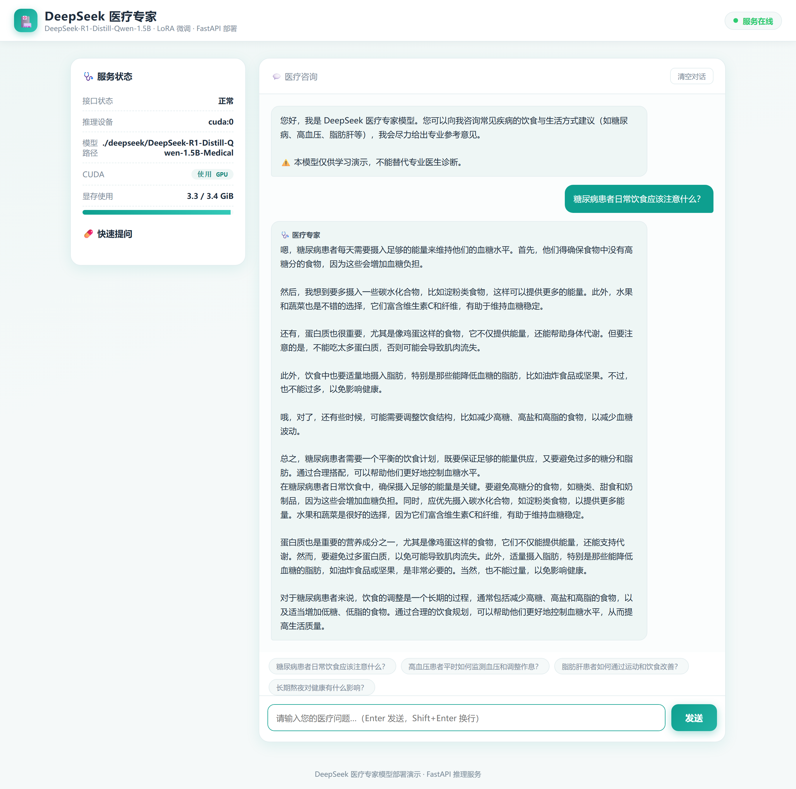
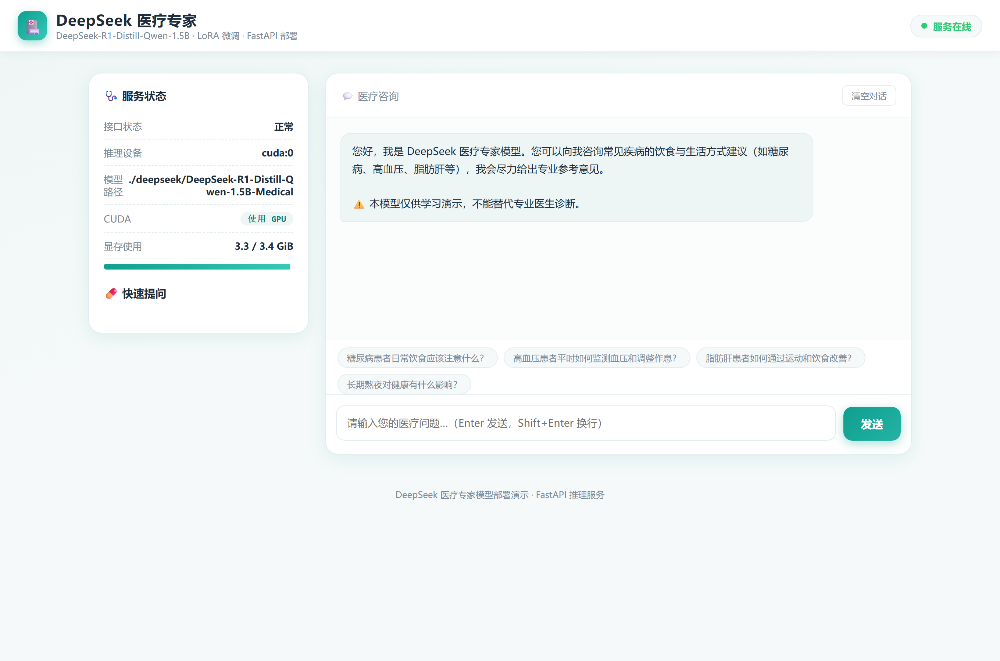
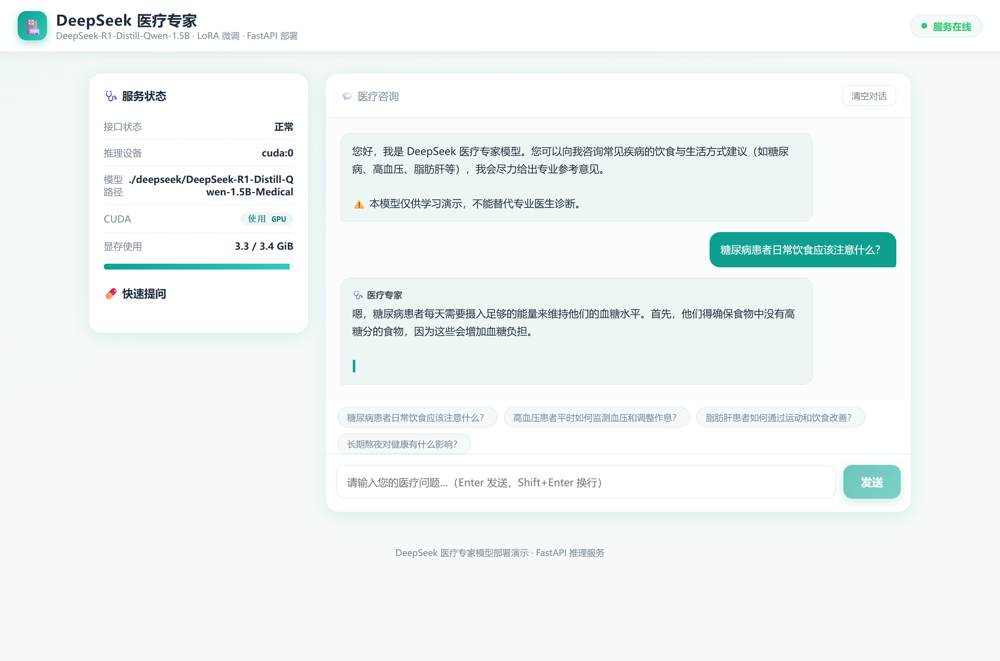
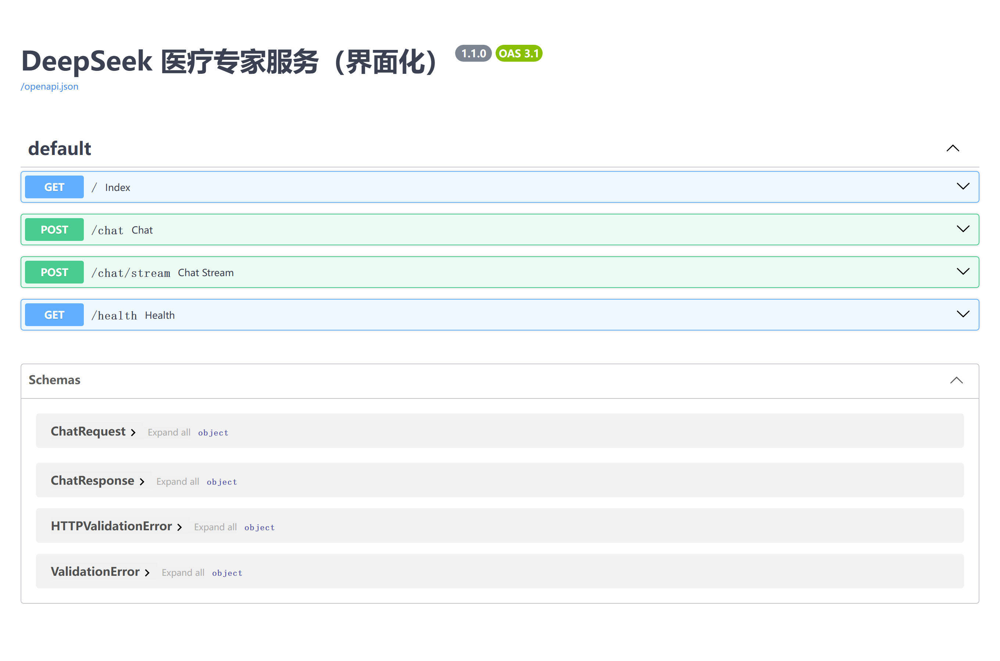
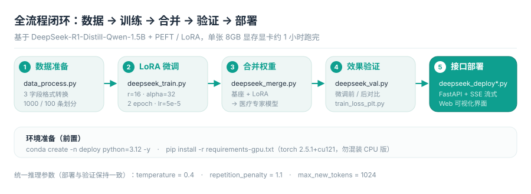
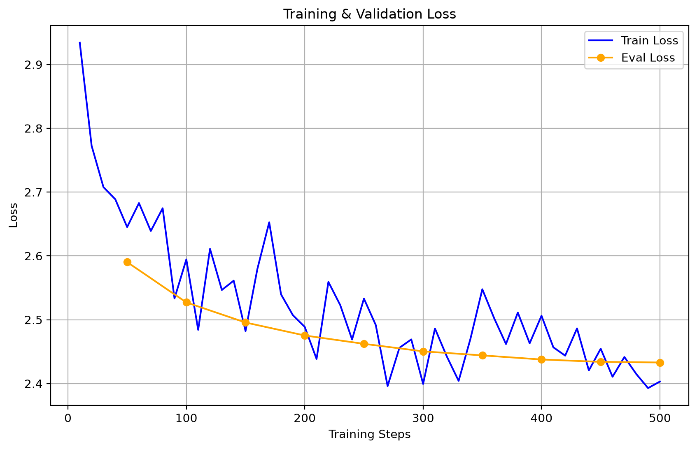

<div align="center">

# 🏥 DeepSeek 医疗专家大模型

**基于 DeepSeek-R1-Distill-Qwen-1.5B + PEFT / LoRA 的医疗领域微调与部署全流程**

[](https://www.python.org/)
[](https://pytorch.org/)
[](https://github.com/huggingface/peft)
[](https://fastapi.tiangolo.com/)
[](https://huggingface.co/deepseek-ai/DeepSeek-R1-Distill-Qwen-1.5B)
[](#-硬件与环境要求)

从**环境准备 → 数据转换 → LoRA 微调 → 权重合并 → 效果验证 → 接口部署**的完整闭环，
单张 8GB 显存显卡约 1 小时即可跑完全流程。

</div>

---

## 📸 产品界面

下面是**真实运行截图**（本机 RTX 显卡、`cuda:0`、加载合并后的医疗专家模型）：



> 左侧为服务状态面板（接口状态 / 推理设备 / 模型路径 / 显存占用），右侧为医疗咨询区，
> 回答通过 **SSE 流式**逐字返回，底部提供糖尿病 / 高血压 / 脂肪肝等常见病快捷提问。

### 服务启动后的初始界面



### 流式生成过程（逐字输出，光标闪烁）



### FastAPI 接口文档（Swagger UI）

`http://127.0.0.1:8001/docs` —— 提供 `/chat`（一次性返回）、`/chat/stream`（SSE 流式）、`/health`（健康检查）三个接口：



---

## ✨ 项目亮点

| 亮点 | 说明 |
| --- | --- |
| **全流程闭环** | 数据清洗 → 格式转换 → LoRA 微调 → 权重合并 → 前后对比 → API/界面部署，每一环都有独立脚本与可复现命令 |
| **硬件门槛低** | 1.5B 基座 + LoRA，**8GB 显存**笔记本显卡即可训练；1000 条 × 2 epoch 约 1 小时 |
| **可复现的划分数** | 固定随机种子 `SEED=42`，`data_process.py` 每次划分结果完全一致 |
| **真实产品界面** | 自带单页 Web 界面（FastAPI 直接托管），支持 SSE 逐字流式输出、显存占用可视化、一键清空对话 |
| **踩坑经验已固化** | 推理参数（`temperature=0.4` + `repetition_penalty=1.1` + `max_new_tokens=1024`）专门用于抑制 1.5B 长文本复读 |
| **诚实的效果边界** | 明确标注这是「医疗表达范式模仿」而非临床诊断，演示题限定为开放式常见病咨询 |

---

## 🏗️ 全流程架构



---

## 📂 项目结构

```text
deepseek医疗专家/
├── 📄 README.md                      # 本说明文档
├── 📄 复现与部署说明.md               # 面向接收者的从零复现手册（含硬件要求）
├── 📄 项目任务书.md                   # 项目目标、任务分解、验收标准
├── 📄 .gitignore
├── 📄 requirements-gpu.txt            # GPU 依赖（内置 torch cu121 官方源）
├── 📄 requirements-cpu.txt            # CPU 推理依赖
│
├── 🐍 model_download.py               # ① 从魔搭(ModelScope)下载基座模型
├── 🐍 data_process.py                 # ② 原始数据 → dataset/*.jsonl
├── 🐍 deepseek_train.py               # ③ LoRA 微调训练
├── 🐍 train_loss_plt.py               # ④ 绘制 Train/Eval Loss 曲线
├── 🐍 deepseek_merge.py               # ⑤ 合并 LoRA → 医疗专家模型
├── 🐍 deepseek_val.py                 # ⑥ 微调前后对比验证（教学重点）
├── 🐍 deepseek_demo.py                # ⑦ 快速单题演示
├── 🐍 deepseek_infer.py               # 教学：理解未微调基座的输出结构
├── 🐍 deepseek_deploy.py              # ⑧ 纯 API 服务（端口 8000）
├── 🐍 deepseek_deploy_ui.py           # ⑨ 界面化服务（端口 8001，SSE 流式）
├── 🌐 deepseek_ui.html                # 界面化服务的 Web 前端
├── 🟨 capture_shot.js                 # 用 Chrome DevTools Protocol 抓取真实界面截图
├── 🟦 pack.ps1                        # 打包「可复现部署包」脚本
│
├── 📁 assets/                         # README 配图（真实界面截图 + 架构图）
├── 📁 data/                           # 原始数据集目录（见 data/README.md）
├── 📁 dataset/                        # 转换后的训练/验证集（已提交，可直接训练）
├── 📁 deepseek/                       # 基座模型 / 合并模型目录（体积大，未提交）
├── 📁 output/                         # 训练产物：loss 曲线、对比存档、训练元数据
└── 📁 docs/                           # 汇报材料：PPT + 现场演示脚本 + PPT 生成脚本 + PPT 配图(docs/assets)
```

> `assets/` 是 README 的配图目录；`docs/assets/` 是 PPT 生成脚本 `build_deck.js` 引用的版式素材，两者互不影响。

> **关于未提交的大文件**：模型权重（约 7.1GB）与原始数据集（约 170MB）超出 GitHub 单文件 100MB 上限，
> 已在 `.gitignore` 中排除。仓库已包含 `dataset/train.jsonl`（1000 条）与 `dataset/val.jsonl`（100 条），
> **克隆后无需下载原始数据即可直接开始训练**。

---

## 🚀 快速上手

### 步骤 0 · 环境准备

```bash
conda create -n deploy python=3.12 -y
conda activate deploy

# 有 NVIDIA 显卡（推荐）
pip install -r requirements-gpu.txt -i https://mirrors.aliyun.com/pypi/simple/
# 无显卡（仅推理，速度极慢）
pip install -r requirements-cpu.txt -i https://mirrors.aliyun.com/pypi/simple/
```

> ⚠️ PyTorch **必须使用 CUDA 12.1 版本**（`torch 2.5.1+cu121`）。`requirements-gpu.txt` 内已内置
> `--extra-index-url https://download.pytorch.org/whl/cu121`；请勿再对 PyTorch 单独混用 `-i` 与
> `--extra-index-url`，否则极易装成 CPU 版导致训练极慢。

### 步骤 1 · 下载基座模型（约 3.5GB）

```bash
python model_download.py     # 通过 ModelScope 下载到 ./deepseek/DeepSeek-R1-Distill-Qwen-1.5B
```

### 步骤 2 · 数据准备

```bash
python data_process.py       # 读 ./data/medical_cot_zh.jsonl → 生成 ./dataset/*.jsonl
```

原始数据获取方式见 [`data/README.md`](data/README.md)。
可用脚本顶部的 `TRAIN_COUNT` / `VAL_COUNT` / `MAX_COT_CHARS` 控制采样量与思考链长度。

> 仓库已自带划分好的 `dataset/`，**只想跑训练的话可以跳过本步**。

### 步骤 3 · LoRA 微调 + 损失曲线

```bash
python deepseek_train.py     # LoRA 微调，checkpoint 保存到 ./output
python train_loss_plt.py     # 读取 trainer_state.json，绘制 Train/Eval Loss 曲线
```

### 步骤 4 · 合并 LoRA → 医疗专家模型

```bash
python deepseek_merge.py     # 输出 ./deepseek/DeepSeek-R1-Distill-Qwen-1.5B-Medical
```

> 若你的 checkpoint 编号不是 `checkpoint-500`，请把 `deepseek_merge.py` 中的
> `model_id="output/checkpoint-500"` 改成实际最新目录。

### 步骤 5 · 效果验证 / 现场演示

```bash
python deepseek_val.py       # 同一道问诊题，对比「微调前 vs 微调后」回答风格
python deepseek_demo.py      # 只加载合并模型，单题几秒出结果（现场用）
```

### 步骤 6 · 启动服务

```bash
python deepseek_deploy.py       # 纯 API：http://127.0.0.1:8000/docs
python deepseek_deploy_ui.py    # 界面化：http://127.0.0.1:8001/
```

> 两个脚本需**另开终端**分别运行。局域网演示请使用本机 IP（如 `http://192.168.x.x:8001`），
> 日志里的 `0.0.0.0` 是服务监听地址，浏览器不能直接访问。

---

## 🔌 接口说明

| 方法 | 路径 | 说明 | 返回 |
| --- | --- | --- | --- |
| `GET` | `/` | 可视化 Web 界面 | HTML 页面 |
| `POST` | `/chat` | 提交问题，一次性返回完整回答 | `{"answer": "..."}` |
| `POST` | `/chat/stream` | 提交问题，**SSE 流式**逐片返回 | `data: {"delta": "..."}` |
| `GET` | `/health` | 健康检查（含显存占用） | `{"status":"ok","device":"cuda:0",...}` |
| `GET` | `/docs` | Swagger 交互式接口文档 | — |

```bash
# 调用示例
curl -X POST http://127.0.0.1:8001/chat \
     -H "Content-Type: application/json" \
     -d '{"question": "糖尿病患者日常饮食应该注意什么？"}'
```

---

## 🧪 训练结果

**Train / Eval Loss 收敛曲线**（500 步，`eval_loss` 从 2.587 降至 2.430）：



**微调前后回答风格对比**：完整存档见
[`output/val_compare_20260910_103144.txt`](output/val_compare_20260910_103144.txt)。

> 同题对比（"2型糖尿病患者在日常生活中，饮食控制和运动方面有哪些建议？"）可以观察到：
> 微调后模型的回答**更贴近医学建议的条目化表达范式**（分点、加粗小标题、结论句收尾），
> 但 1.5B 小参数量基座在长文本上仍存在**复读与逻辑不稳**的问题——
> 这正是部署侧统一使用低温度（0.4）+ 重复惩罚（1.1）+ 限长（1024）来抑制的原因。
> 教学演示聚焦于「表达范式与结构规范」，**不代表诊断准确性**。

---

## 🔍 关键实现说明

### 数据格式

统一为三字段 JSONL，`output` 由「思考链 + 答案」拼接，让模型学习"先思考后回答"的医学推理模式：

```json
{
  "input": "患者提问 / 症状描述",
  "output": "Complex_CoT（思考过程，按 MAX_COT_CHARS 截断）\nResponse（完整答案）",
  "instruction": "你是专业的医疗领域专家，具备扎实的医学知识和严谨的临床推理能力……"
}
```

### LoRA 配置

```python
LoraConfig(
    task_type=TaskType.CAUSAL_LM,
    r=16,                      # 低秩矩阵维数
    lora_alpha=32,             # 缩放系数
    lora_dropout=0.05,
    target_modules=["q_proj", "k_proj", "v_proj", "o_proj",
                    "gate_proj", "up_proj", "down_proj"],  # 覆盖全部注意力与 MLP 矩阵
)
```

### 训练参数

| 参数 | 取值 | 说明 |
| --- | --- | --- |
| 训练轮数 | 2 epoch | 1000 条 × 2 epoch ≈ 500 步 |
| 学习率 | `5e-5` | — |
| batch size | `1` + `grad_accum=4` | 有效 batch = 4，8GB 显存可跑 |
| `eval_steps` / `save_steps` | 50 / 25 | `save_total_limit=2` |
| 正则化 | `warmup_steps=10`、`weight_decay=0.02` | 缓解损失震荡 |
| 思考链截断 | 600 字符 | 缩短序列长度，加快单步训练 |

### 推理采样参数（重要）

三个脚本（`deepseek_val.py` / `deepseek_deploy.py` / `deepseek_deploy_ui.py`）**必须保持一致**：

```python
temperature=0.4, repetition_penalty=1.1, max_new_tokens=1024, top_p=0.8
```

> 默认的 `do_sample(temp=1.0)` + 超长 `max_new_tokens` 会让 1.5B 模型的输出失控、整段复读——这是本项目实测踩过的坑。

---

## ❓ 常见问题

| 现象 | 排查 / 解决 |
| --- | --- |
| 训练或推理极慢 | 确认装的是 CUDA 12.1 版 torch 而非 CPU 版（`python -c "import torch;print(torch.cuda.is_available())"` 应为 `True`） |
| pip 装错包 / 版本冲突 | 不要混用 `-i` 与 `--extra-index-url`，固定使用阿里云镜像加速通用包 |
| 找不到 `/chat` 服务 | 先跑 `deepseek_merge.py` 生成合并模型；`deepseek_deploy*.py` 引用的是 `...-1.5B-Medical` 目录 |
| checkpoint 路径报错 | 同步修改 `deepseek_merge.py` / `deepseek_val.py` 中的 checkpoint 编号 |
| 浏览器打不开 `0.0.0.0:8001` | 改用 `127.0.0.1:8001` 或本机局域网 IP |
| 回答重复、自相矛盾 | 检查生成参数是否与 `0.4 / 1.1 / 1024` 一致 |
| 想复现本次效果 | 直接使用仓库内的 `dataset/` 训练，或走「步骤 4 合并 + 步骤 6 部署」 |

---

## 🛠️ 技术栈

| 层次 | 选型 |
| --- | --- |
| 基座模型 | DeepSeek-R1-Distill-Qwen-1.5B（Qwen2.5 架构，R1 推理数据蒸馏） |
| 微调 | HuggingFace Transformers `Trainer` + PEFT（LoRA）+ `DataCollatorForSeq2Seq` 做标签对齐 |
| 数据 | `datasets` / JSONL 三字段格式 |
| 模型分发 | ModelScope `snapshot_download` |
| 服务 | FastAPI + Uvicorn，`TextIteratorStreamer` 实现 SSE 流式 |
| 前端 | 单页 HTML + 原生 JS（无构建步骤） |
| 可视化 | Matplotlib（损失曲线）、Chrome DevTools Protocol（界面截图） |

---

## ⚠️ 免责声明

- 本项目为**课程教学 / 技术演示**用途，用于演示大模型领域微调的完整工程流程。
- 1.5B 基座 + LoRA 达成的是**医疗领域表达范式与规范建议的风格模仿**，输出**仅供参考**，
  **不能替代专业医生的诊断与治疗**。
- 训练数据来源于公开医学问答数据集，本项目不对其内容准确性作任何担保。
- 演示题请限定为开放式常见病咨询（糖尿病 / 高血压 / 脂肪肝等），
  **避免**使用急诊急救等需要精确鉴别的题目。

---

<div align="center">

**如果这个项目对你有帮助，欢迎 Star ⭐**

</div>
